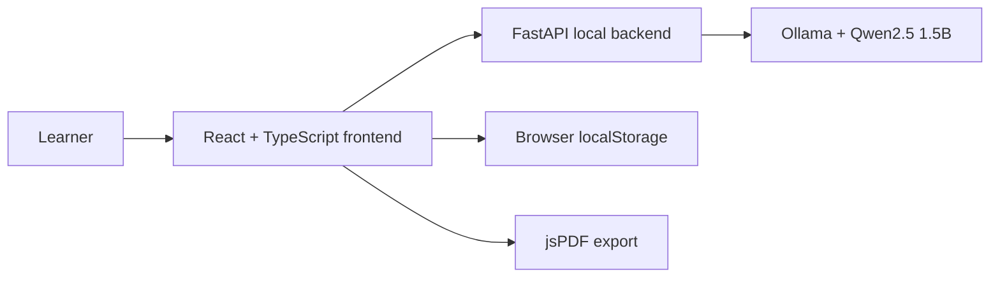

# PurposePath AI

### Your future. Your choice.

**Functional, offline-first AI prototype for self-discovery, educational exploration, and career guidance.**

 

## Purpose

PurposePath AI helps learners reflect on interests, strengths, constraints and intended social impact, while considering university, vocational education, entrepreneurship and hybrid pathways fairly. It is designed to help learners make informed choices, not prescribe careers.

## Why it matters

Educational guidance can be difficult to access where connectivity, affordability and qualified support are constrained. PurposePath AI explores local-first personalized guidance without depending on a hosted generative-AI service for inference.

## Current functionality

- Guided self-discovery questionnaire and editable Statement of Purpose
- Five-step personal roadmap
- Conversational AI guide powered by local Ollama inference
- Interface language options: English, Yoruba, Igbo, Hausa and Nigerian Pidgin (model response quality varies)
- PDF report and chat response export
- Browser-local reflection saving, dark mode, and delete controls
- No mandatory account

**Development status:** Functional web prototype; offline generation was tested locally with Ollama after model installation. Not yet a standalone offline Android app, verified career assessment, or production deployment.

## Technology stack

        

**AI:** Ollama with Qwen2.5 1.5B. **PDF:** jsPDF. **UI icons:** Lucide React.

## Architecture



Local inference uses a running Ollama service. The model and software dependencies require an initial download; once installed, the configured computer can generate responses offline. Text quality and performance vary by model and hardware.

## Run locally

**Requirements:** Python, Node.js/npm, and Ollama with `qwen2.5:1.5b` downloaded.

```powershell
ollama pull qwen2.5:1.5b
cd backend
python -m venv .venv
.\.venv\Scripts\python.exe -m pip install fastapi uvicorn pydantic httpx
.\.venv\Scripts\python.exe -m uvicorn main:app --reload
```

In another PowerShell terminal:

```powershell
cd frontend
npm install
npm run dev
```

Visit `http://localhost:5173`. The frontend expects the local backend at `http://127.0.0.1:8000`. This setup assumes the source code is present under `frontend/` and `backend/` — application code has not yet been uploaded to this repository.

## Research and public policy — Africa & Global Power (AGP)

The prototype motivates a **future, independently researched AGP publication** on localized offline AI for educational and career guidance. The working research question is:

> Can offline, localized AI support more equitable educational and career exploration in connectivity-constrained Nigerian communities?

Potential research areas include digital access gaps, language accessibility and translation accuracy, educational pathway bias, the quality of AI-generated recommendations, learner comprehension, privacy, and the operational cost of deployment.

A credible study would use literature review, stakeholder engagement with educators and learners, field observations or consent-based pilots, and evaluation of both model errors and user outcomes. **No field-study findings or measurable educational impact are claimed at this stage.**

The intention is to translate findings into evidence-based recommendations for relevant education ministries, state education authorities, guidance and counselling institutions, and education-sector agencies. Potential interventions should be evaluated before being recommended for adoption.

## Responsible use and limitations

- Outputs are editable reflections, not official admissions advice or accredited professional assessments.
- The small local model can hallucinate, repeat itself, misinterpret student intent, and vary in multilingual quality.
- Learners should verify requirements and costs with official sources and consult trusted educators or guardians where appropriate.
- The browser stores reflections locally; downloaded PDF files require separate deletion.
- A successful local offline demo does not establish scalability, mobile readiness, universal accessibility, or educational efficacy.

## Hackathon demonstration

1. Start local backend and Ollama with the model installed.
2. Disconnect internet access and verify AI readiness.
3. Complete self-discovery and generate a personal statement plus five-step roadmap.
4. Explore alternative education and career pathways.
5. Ask the local AI guide a question and export a PDF.
6. Discuss limitations and planned AGP research evaluation.

## Logo

The application currently uses a compass icon from **Lucide React** as its in-app brand mark. A standalone, original official logo asset has not yet been published to this repository.

## Project direction

Built for exploration in the context of the Wale Lab NextGen AI Hackathon, Track 1 (AI for Zero-Bandwidth & Localized Learning). Further plans include more rigorous offline usability testing, evidence-based language evaluation, and policy-relevant research through **Africa & Global Power (AGP)**.

**Maintainer:** [Wahab Opeyemi Badmus](https://github.com/abdulwahabbadmus001-creator)
